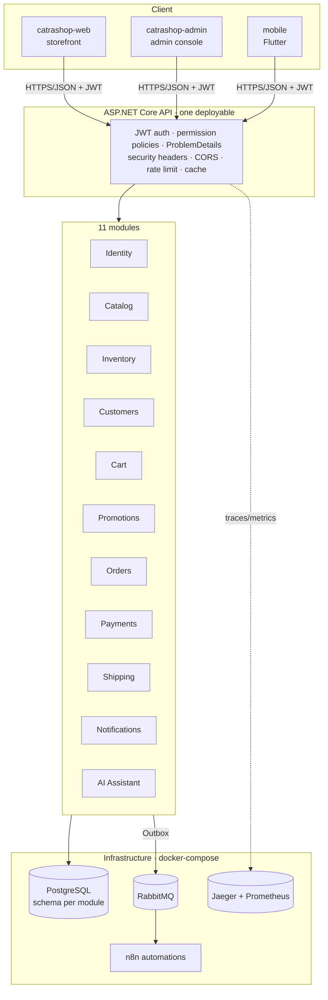

# Catrashop

An online store for Honduras built on .NET 10, Angular 22 and Flutter: a customer storefront, an admin console and a
mobile app for operators, all on top of one modular API.

[](#stack)
[](#stack)
[](#mobile-app)

---

## Table of contents
- [About](#about)
- [What it covers](#what-it-covers)
- [Architecture](#architecture)
- [Stack](#stack)
- [Prerequisites](#prerequisites)
- [Quick start](#quick-start)
- [Mobile app](#mobile-app)
- [Deployment](#deployment)
- [Git workflow](#git-workflow)
- [Documentation map](#documentation-map)

---

## About

Catrashop started as a university project: an online store written in Laravel with Blade. It was rebuilt from scratch
on a modern stack: a **.NET** backend, an **Angular** web app, and a **Flutter** app so the system reaches beyond the
browser and covers store operations from a phone as well.

The store is Spanish-first and sells in Honduran lempiras (HNL), with national shipping by zone and payment methods that
match how people actually pay there.

## What it covers

- **Storefront:** catalog with search, filters and sorting, product pages, wishlist, cart, checkout and order tracking,
  in Spanish and English.
- **Orders and payments:** cash on delivery, bank transfer (with receipt and manual verification) and pay at the store,
  depending on the delivery option. Payments are simulated; no real payment processor is connected.
- **Shipping:** delivery by zone across the 18 departments of Honduras, plus pickup stores.
- **Promotions and notifications:** coupons, in-app and e-mail notifications in the customer's language.
- **Admin console:** products, inventory, orders, payments, coupons and notifications, behind role-based permissions.
- **Mobile app:** order and payment management for operators.
- **Assistant:** a shopping assistant limited to a small set of read-only tools.

## Architecture

The backend is a **modular monolith**: eleven modules with their own data and a small public contract each, deployed as
one API. Architecture tests fail the build when a module reaches into another one's internals, and side effects such as
e-mail go through an outbox to RabbitMQ.



The module map, the checkout sequence, the order lifecycle and the outbox flow are in
[`docs/architecture`](docs/architecture/README.md). The reasoning behind the monolith is in
[ADR-001](docs/adr/001-modular-monolith.md).

## Stack

| Layer | Technology |
|---|---|
| Web | Angular 22 (standalone, zoneless, signals), TypeScript, Transloco |
| Mobile | Flutter (Android and iOS), Riverpod |
| Backend | .NET 10, ASP.NET Core minimal APIs, EF Core + Npgsql, FluentValidation, OpenAPI |
| Auth | JWT bearer + refresh tokens, BCrypt, permission policies |
| Database | PostgreSQL (schema per module, full-text search) |
| Messaging | RabbitMQ (outbox → publisher → consumers) |
| Automation | n8n |
| Observability | Structured logging, OpenTelemetry (Prometheus, OTLP, Jaeger), health probes |
| Testing | xUnit, NetArchTest, WebApplicationFactory; Vitest and Playwright; Flutter tests |
| Delivery | Docker Compose, GitHub Actions (build, tests, security scans, Dependabot) |

## Prerequisites

- .NET SDK **10.0.400+** (pinned in [`backend/global.json`](backend/global.json))
- Node **24+** and **pnpm 11+**
- Docker Desktop (Postgres, RabbitMQ, n8n and the optional Jaeger/Prometheus profile)
- Flutter SDK, only for the mobile app
- Git

## Quick start

```bash
# 1. Infrastructure (add --profile observability for Jaeger + Prometheus)
docker compose up -d

# 2. Apply the EF Core migrations (each module owns its own; the app does not migrate on startup)
#    e.g. per context:  dotnet ef database update --project backend/src/Modules/Identity/Catrashop.Modules.Identity

# 3. Backend
dotnet run --project backend/src/Api/Catrashop.Api

# 4. Storefront (http://localhost:4200)
cd frontend && pnpm install && pnpm start
#    and the admin console (http://localhost:4300)
pnpm ng serve catrashop-admin
```

[`docs/local-development.md`](docs/local-development.md) covers secrets, the database and the seed script, and
[`docs/demo-data.md`](docs/demo-data.md) walks the full purchase journey through the API. Secrets are never committed;
see [`.env.example`](.env.example).

## Mobile app

`mobile/` is a Flutter app for operators: sign in as an admin, filter orders and move them through processing, shipping
and delivery, review bank-transfer receipts and register collections. It has biometric unlock, local notifications for
new orders, and no Firebase. See [`mobile/README.md`](mobile/README.md).

## Deployment

The API runs on an Oracle VM (systemd, Apache, Cloudflare), the frontends on Vercel and the mobile app as APK/IPA.
Step by step in [`docs/deployment.md`](docs/deployment.md).

## Git workflow

`main` ← `develop` ← `feature/*` and `fix/*`. Everything goes through a pull request and a merge commit, with
Conventional Commits. CI builds and tests the backend and both web apps, and a separate workflow runs CodeQL, secret
scanning and dependency audits. See the [CHANGELOG](CHANGELOG.md) for what changed in each release.

## Documentation map

Start at the [documentation hub](docs/README.md), or jump straight in:

| Path | Contents |
|---|---|
| [`docs/architecture`](docs/architecture/README.md) | Module map, boundaries, checkout sequence, order lifecycle, outbox and assistant diagrams |
| [`docs/adr`](docs/adr/README.md) | Architecture decision records |
| [`docs/git/prs`](docs/git/prs/README.md) | Pull request write-ups |
| [`docs/roadmap.md`](docs/roadmap.md) | Build plan by phase |
| [`docs/demo-data.md`](docs/demo-data.md) | Driving the system end to end |
| [`docs/local-development.md`](docs/local-development.md) | Local setup: secrets, database, seed script, web and mobile |
| [`docs/deployment.md`](docs/deployment.md) | Oracle VM, Vercel and mobile release guide |
| [`mobile/`](mobile/README.md) | Flutter admin app |
| [`CHANGELOG.md`](CHANGELOG.md) | Release history |
