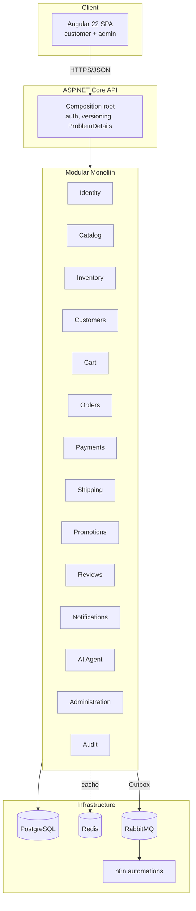

# CommerceHub

> A modular-monolith, event-driven **enterprise e-commerce platform** built with .NET 10 + Angular 22, designed as a realistic reference of how production commerce software is structured, secured, tested, and operated.

[](#project-status)
[](#stack)
[](#stack)

---

## Table of contents
- [Overview](#overview)
- [The business problem](#the-business-problem)
- [Architecture](#architecture)
- [Why a modular monolith?](#why-a-modular-monolith)
- [Stack](#stack)
- [Prerequisites](#prerequisites)
- [Quick start](#quick-start)
- [Project status](#project-status)
- [Git workflow](#git-workflow)
- [Documentation map](#documentation-map)

---

## Overview

CommerceHub is a full commerce platform covering the real lifecycle of an online store: catalog and inventory,
cart and checkout, orders, (simulated) payments, shipping, promotions, reviews, notifications, an AI shopping
assistant with **strictly bounded** tools, and back-office administration with auditing. It is built as a
**modular monolith** — independent modules with enforced boundaries that can be extracted into services later
*if and when* a real reason appears, not before.

## The business problem

Mid-market retailers need a platform that is cheap to operate, fast to evolve, and safe to change — without the
operational tax of a premature microservice fleet. CommerceHub targets that sweet spot: one deployable unit, clear
internal seams, event-driven side effects (email, analytics, fulfillment), and an AI assistant that can help
customers **without ever being able to leak or mutate data it shouldn't touch**.

## Architecture



See [`docs/architecture`](docs/architecture) for module boundaries, the checkout sequence, the order lifecycle
state machine, and the AI agent boundary diagram.

## Why a modular monolith?

Distributed systems trade *in-process* complexity (a method call) for *distributed* complexity (network,
partial failure, eventual consistency, deploy choreography, distributed tracing just to read a stack trace). For a
product at this stage that trade is a **net loss**: you pay the operational cost immediately and collect the
scaling benefit maybe never. A modular monolith keeps the one thing microservices are genuinely good at —
**enforced module boundaries** — while deferring the costs:

- **Boundaries without the network.** Each module exposes a small public contract (commands/queries/events) and
  hides its `Domain`/`Infrastructure` internals. Architecture tests fail the build if one module reaches into
  another's internals. That's the same discipline a service boundary gives you, enforced by the compiler + CI
  instead of by HTTP.
- **One transaction when you need one.** Checkout touches cart, inventory, pricing, orders and payments. In a
  monolith the consistency-critical part is a single ACID transaction; cross-module side effects go through the
  **Outbox** as events. No sagas required for the happy path.
- **One deploy, one trace, one log stream.** Debuggable by a single engineer on a laptop.
- **Extraction stays open.** Because communication already goes through contracts and events, promoting a module
  to a service later is a mechanical change, not a rewrite.

Full reasoning: [ADR-001 — Modular Monolith](docs/adr/001-modular-monolith.md).

## Stack

| Layer | Technology |
|---|---|
| Frontend | Angular 22 (standalone, signals, reactive forms), TypeScript |
| Backend | .NET 10, ASP.NET Core, EF Core, FluentValidation, OpenAPI |
| Database | PostgreSQL (+ full-text search) |
| Cache / rate-limit | Redis |
| Messaging | RabbitMQ (Outbox → publisher → consumers) |
| Automation | n8n |
| AI | Provider-abstracted LLM + bounded tool-calling + RAG for policies |
| Observability | Serilog structured logs, OpenTelemetry traces/metrics, health checks |
| Testing | xUnit, Testcontainers, Playwright, architecture tests |
| Delivery | Docker Compose, GitHub Actions |

## Prerequisites

- .NET SDK **10.0+**
- Node **20+** and **pnpm** (Angular 22)
- Docker Desktop (for Postgres, Redis, RabbitMQ, n8n)
- Git

## Quick start

> Full instructions are added as each service comes online. The intended developer experience is:

```bash
# 1. Bring up infrastructure (Postgres, Redis, RabbitMQ, n8n)
docker compose up -d

# 2. Run the backend (applies migrations on startup in Development)
dotnet run --project backend/src/Api

# 3. Run the frontend
cd frontend && pnpm install && pnpm start
```

Demo credentials and seed data are documented in [`docs/demo-data.md`](docs/demo-data.md) once seeding lands. No
real secrets are ever committed — see [`.env.example`](.env.example).

## Project status

This repository is built **incrementally, phase by phase** (see the 24-phase plan in
[`docs/roadmap.md`](docs/roadmap.md)). Every increment is expected to compile; runtime verification of
infrastructure-dependent parts requires Docker to be running. The
[CHANGELOG](CHANGELOG.md) and git tags (`v0.1.0`, …) track the evolution.

## Git workflow

`main` (releasable) ← `release/*` ← `develop` ← `feature/*`. Conventional Commits. Every substantial feature has a
simulated-but-documented PR under [`docs/git/prs`](docs/git/prs) — these are **local workflow simulations**, clearly
labeled as such; no human actually reviewed the code.

## Documentation map

| Path | Contents |
|---|---|
| [`docs/adr`](docs/adr) | Architecture Decision Records |
| [`docs/architecture`](docs/architecture) | System & sequence diagrams |
| [`docs/git/prs`](docs/git/prs) | Simulated PR history |
| [`docs/roadmap.md`](docs/roadmap.md) | The 24-phase build plan |
