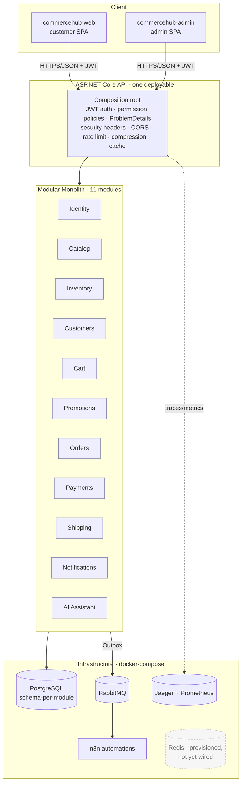

# CommerceHub

> A modular-monolith, event-driven **enterprise e-commerce platform** built with .NET 10 + Angular 22, designed as a realistic reference of how production commerce software is structured, secured, tested, and operated.

[](#project-status)
[](#stack)
[](#stack)

---

## Table of contents
- [Overview](#overview)
- [The business problem](#the-business-problem)
- [Architecture](#architecture)
- [Why a modular monolith?](#why-a-modular-monolith)
- [Stack](#stack)
- [Prerequisites](#prerequisites)
- [Quick start](#quick-start)
- [Mobile app](#mobile-app)
- [Deployment](#deployment)
- [Project status](#project-status)
- [Git workflow](#git-workflow)
- [Documentation map](#documentation-map)

---

## Overview

CommerceHub is a full commerce platform covering the real lifecycle of an online store: identity, catalog and
inventory, cart and checkout, orders, (simulated) payments, shipping, promotions, notifications, and an AI
shopping assistant with **strictly bounded** tools. Back-office administration is a separate Angular app calling
permission-gated endpoints, and security-sensitive actions (login, password changes) are recorded in the
Identity module's audit log. It is built as a **modular monolith** — eleven independent modules with enforced
boundaries that can be extracted into services later *if and when* a real reason appears, not before.

## The business problem

Mid-market retailers need a platform that is cheap to operate, fast to evolve, and safe to change — without the
operational tax of a premature microservice fleet. CommerceHub targets that sweet spot: one deployable unit, clear
internal seams, event-driven side effects (email, analytics, fulfillment), and an AI assistant that can help
customers **without ever being able to leak or mutate data it shouldn't touch**.

## Architecture



See [`docs/architecture`](docs/architecture/README.md) for the module map, module-boundary enforcement, the
checkout sequence, the order lifecycle state machine, the Outbox flow, and the AI assistant boundary diagram.

## Why a modular monolith?

Distributed systems trade *in-process* complexity (a method call) for *distributed* complexity (network,
partial failure, eventual consistency, deploy choreography, distributed tracing just to read a stack trace). For a
product at this stage that trade is a **net loss**: you pay the operational cost immediately and collect the
scaling benefit maybe never. A modular monolith keeps the one thing microservices are genuinely good at —
**enforced module boundaries** — while deferring the costs:

- **Boundaries without the network.** Each module exposes a small public contract (commands/queries/events) and
  hides its `Domain`/`Infrastructure` internals. Architecture tests fail the build if one module reaches into
  another's internals. That's the same discipline a service boundary gives you, enforced by the compiler + CI
  instead of by HTTP.
- **One transaction when you need one.** Checkout touches cart, inventory, pricing, orders and payments. In a
  monolith the consistency-critical part is a single ACID transaction; cross-module side effects go through the
  **Outbox** as events. No sagas required for the happy path.
- **One deploy, one trace, one log stream.** Debuggable by a single engineer on a laptop.
- **Extraction stays open.** Because communication already goes through contracts and events, promoting a module
  to a service later is a mechanical change, not a rewrite.

Full reasoning: [ADR-001 — Modular Monolith](docs/adr/001-modular-monolith.md).

## Stack

| Layer | Technology |
|---|---|
| Frontend | Angular 22 (standalone, **zoneless**, signals, reactive forms, `withFetch`), TypeScript |
| Backend | .NET 10, ASP.NET Core (minimal APIs), EF Core + Npgsql, FluentValidation, OpenAPI |
| Auth | JWT bearer + refresh tokens; BCrypt password hashing; on-demand permission policies |
| Database | PostgreSQL (schema-per-module, snake_case, full-text search) |
| Rate-limit / cache | In-process (framework rate limiter + output cache). *Redis is provisioned in compose but not yet wired.* |
| Messaging | RabbitMQ (Outbox → publisher → consumers) |
| Automation | n8n |
| AI | Provider-abstracted `IChatModel` + bounded tool-calling + RAG over a seeded KB |
| Observability | Structured JSON logging (`Microsoft.Extensions.Logging`), OpenTelemetry traces/metrics (Prometheus/OTLP/Jaeger), health probes |
| Testing | xUnit, NetArchTest (architecture), WebApplicationFactory (integration) + Postgres-gated E2E; Vitest + Playwright (frontend) |
| Delivery | Docker Compose, GitHub Actions (build/test + security scanning) |

## Prerequisites

- .NET SDK **10.0.400+** (pinned in [`backend/global.json`](backend/global.json))
- Node **24+** and **pnpm 11+** (Angular 22)
- Docker Desktop (for Postgres, RabbitMQ, n8n, and the opt-in Jaeger/Prometheus profile)
- Git

## Quick start

```bash
# 1. Bring up infrastructure (Postgres, RabbitMQ, n8n; add --profile observability for Jaeger + Prometheus)
docker compose up -d

# 2. Apply EF Core migrations (each module owns its own; the app does NOT auto-migrate on startup)
#    e.g. per context:  dotnet ef database update --project backend/src/Modules/Identity/CommerceHub.Modules.Identity

# 3. Run the backend
dotnet run --project backend/src/Api/CommerceHub.Api

# 4. Run the customer SPA (http://localhost:4200)
cd frontend && pnpm install && pnpm start
#    …and the admin SPA (http://localhost:4300)
pnpm ng serve commercehub-admin
```

There is no automated seed script yet; [`docs/demo-data.md`](docs/demo-data.md) walks the full journey through
the API in the meantime. No real secrets are ever committed — see [`.env.example`](.env.example).

## Mobile app

`mobile/` is a Flutter app (Android + iOS) for operators: sign in as an admin, list/filter orders and advance them
(process → ship → deliver) or cancel. Biometric unlock, no Firebase. See [`mobile/README.md`](mobile/README.md).

## Deployment

API on an Oracle VM (systemd + Apache + Cloudflare, no Docker, no RabbitMQ), frontends on Vercel, mobile as
APK/IPA. Step by step in [`docs/deployment.md`](docs/deployment.md).

## Project status

Built **incrementally, phase by phase** (see the 24-phase plan in [`docs/roadmap.md`](docs/roadmap.md)): **all
24 phases complete**, accepted as **release-ready (v1.0.0)** in the [final architectural
review](docs/adr/028-final-architectural-review.md). Every guard is green — backend Release build 0/0, tests
**200 pass / 2 skip**, architecture **66/66**, no vulnerable packages; frontend both apps build, Vitest **23** +
Playwright **3**. Runtime verification of infrastructure-dependent parts requires Docker; the recorded residual
follow-ups live in ADR-028. The [CHANGELOG](CHANGELOG.md) tracks the evolution phase by phase.

## Git workflow

`main` (releasable) ← `release/*` ← `develop` ← `feature/*`. Conventional Commits. Every substantial feature has a
simulated-but-documented PR under [`docs/git/prs`](docs/git/prs) — these are **local workflow simulations**, clearly
labeled as such; no human actually reviewed the code.

## Documentation map

Start at the [documentation hub](docs/README.md), or jump straight in:

| Path | Contents |
|---|---|
| [`docs/architecture`](docs/architecture/README.md) | Module map, boundaries, checkout sequence, order state machine, Outbox & AI diagrams |
| [`docs/adr`](docs/adr/README.md) | Architecture Decision Records (indexed) |
| [`docs/git/prs`](docs/git/prs/README.md) | Simulated PR history |
| [`docs/roadmap.md`](docs/roadmap.md) | The 24-phase build plan |
| [`docs/demo-data.md`](docs/demo-data.md) | Driving the system end to end |
| [`docs/local-development.md`](docs/local-development.md) | Local setup: secrets, DB, seed script, web and mobile |
| [`docs/deployment.md`](docs/deployment.md) | Oracle VM + Vercel + mobile release guide |
| [`mobile/`](mobile/README.md) | Flutter admin app |
| [`CHANGELOG.md`](CHANGELOG.md) | Phase-by-phase history |
