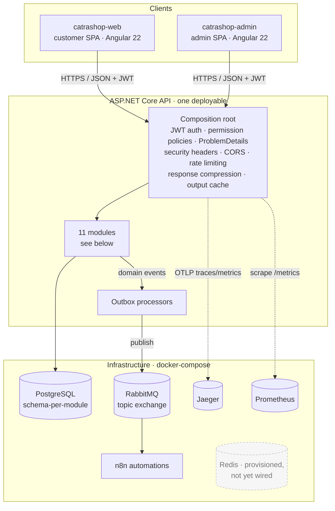
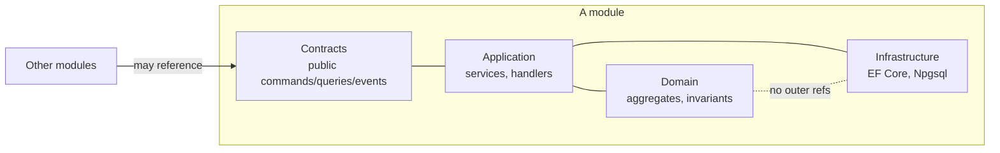
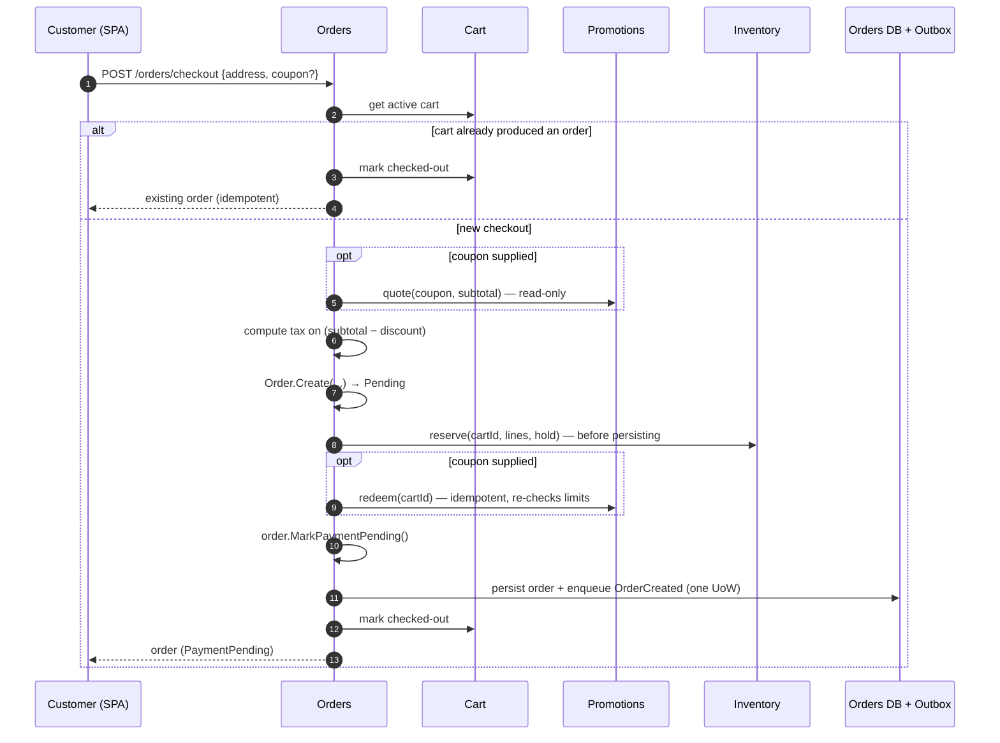
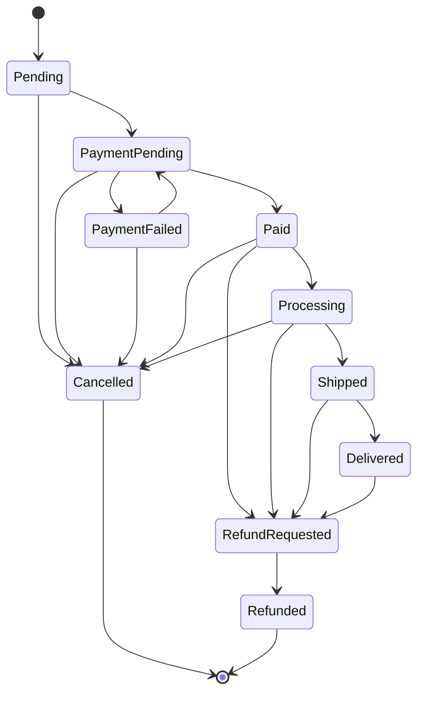
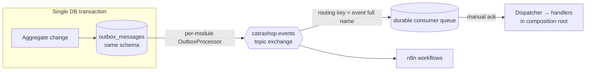
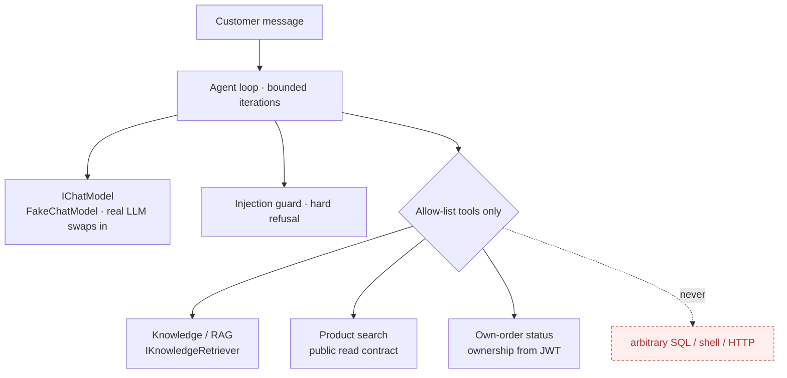

# Catrashop — Architecture

This document reflects the system **as built** through Phase 22. Every diagram is grounded in the current code;
where something is provisioned but not yet wired (e.g. Redis), it says so explicitly.

- [System context](#system-context)
- [The modules](#the-modules)
- [Module boundaries & enforcement](#module-boundaries--enforcement)
- [Checkout sequence](#checkout-sequence)
- [Order lifecycle state machine](#order-lifecycle-state-machine)
- [Messaging: Outbox → RabbitMQ → handlers](#messaging-outbox--rabbitmq--handlers)
- [AI assistant boundary](#ai-assistant-boundary)
- [Cross-cutting concerns](#cross-cutting-concerns)

---

## System context

The API is a **single process**. The SPAs talk to it over JSON with a bearer JWT. Side effects that cross a
module boundary leave through the **Outbox** and are published to RabbitMQ, where in-process consumers and the
n8n workflows react. Jaeger and Prometheus are opt-in (compose profile `observability`). Redis has a compose
service but no backend code references it yet — rate limiting and output caching are currently in-process.

## The modules

Eleven modules, each owning its own PostgreSQL schema, domain, and migrations. They never call each other's
internals — only the small public **`Contracts`** surface and integration events cross a boundary.

| Module | Responsibility | Notable public contract |
|---|---|---|
| **Identity** | Users, roles, permissions, JWT + refresh tokens, password reset, security audit log | auth endpoints; `perm:` policies |
| **Catalog** | Products, variants/SKUs, categories, brands; full-text search | `IProductCatalogQuery` (purchasable variant, search) |
| **Inventory** | On-hand/reserved/sold, movements, idempotent reservations, low-stock events | `IInventoryOperations` (reserve/commit/release) |
| **Customers** | Profile, addresses, wishlist (id = user id, IDOR-safe) | provisioned on `CustomerRegistered` |
| **Cart** | Persistent cart, captured prices, currency guard, sliding expiry | `ICartQuery` (active cart, mark checked-out) |
| **Promotions** | Coupons (%/fixed), rules, usage limits, redemption ledger | `IPromotionApplication` (quote/redeem/release) |
| **Orders** | Checkout orchestration, totals, guarded state machine, history | `IOrderWorkflow`, `IOrderFulfillment` |
| **Payments** | Provider abstraction, payment state machine, idempotency, HMAC webhooks | drives `IOrderWorkflow` |
| **Shipping** | Methods, shipments, tracking, shipment state machine | drives `IOrderFulfillment` |
| **Notifications** | In-app inbox + email, per-customer preferences, idempotent dispatch | `INotificationDispatcher` |
| **AI** | Bounded shopping assistant (tools + RAG + guardrails) | `POST /ai/chat` |

Administration is **not** a backend module — it is the `catrashop-admin` SPA calling permission-gated
endpoints exposed by the modules above. "Auditing" is the security audit log inside **Identity**
(login / password events), not a separate module.

## Module boundaries & enforcement

The boundaries are enforced by the compiler + CI, not by convention. **66 architecture tests** (NetArchTest,
11 modules × 6 rules) fail the build if:

- one module references another module's `Application`/`Domain`/`Infrastructure` (only `Contracts` + events cross);
- a module references the API host;
- `Domain` references EF Core/Npgsql, or `Application` references the Npgsql driver (inward layering);
- integration-event handlers live anywhere but the composition root.

Full reasoning: [ADR-001 — Modular Monolith](../adr/001-modular-monolith.md).

## Checkout sequence

Grounded in `OrderCheckoutService`. There is **no distributed transaction**; consistency comes from ordering
(reserve stock *before* persisting the order), an idempotency key on the cart id, and a reservation that
self-expires if checkout never completes.

Reserving before redeeming means the common failure — a line gone out of stock — never consumes a coupon use.
Payment happens **after** checkout: the Payments module captures payment and drives the order through
`IOrderWorkflow` (→ `Paid` / `PaymentFailed`); Shipping then drives fulfilment through `IOrderFulfillment`.

## Order lifecycle state machine

The exact transition table from `OrderStateMachine` (illegal transitions are rejected by the domain).

`Cancelled` and `Refunded` are terminal. See [ADR-013](../adr/013-order-lifecycle-and-checkout.md).

## Messaging: Outbox → RabbitMQ → handlers

A domain side effect is written to `outbox_messages` **in the same transaction** as the aggregate change, so it
can never be lost or double-committed. Each module's `OutboxProcessor` drains its table and publishes to the
topic exchange using the event's full type name as the routing key. Consumers are idempotent (no inbox table),
and every hosted service tolerates an absent broker so the app still boots offline. See
[ADR-005](../adr/005-outbox-pattern.md) and [ADR-020](../adr/020-messaging-rabbitmq-outbox.md).

## AI assistant boundary

The assistant can only call an **allow-list** of tools over existing public read contracts. Order ownership is
injected from the JWT, never chosen by the model; tool output is treated as data, not instructions; the client
cannot inject system or tool messages; and the loop is bounded. See [ADR-022](../adr/022-ai-assistant.md).

## Cross-cutting concerns

| Concern | Where | ADR |
|---|---|---|
| AuthN/AuthZ | JWT bearer + on-demand `perm:` permission policies | [009](../adr/009-authentication-strategy.md) |
| Security hardening | Response headers, CORS, per-client rate limiting, secret guard | [025](../adr/025-security-hardening.md) |
| Performance | DbContext pooling, no-tracking reads, compression, output cache | [027](../adr/027-performance-review.md) |
| Observability | OpenTelemetry traces/metrics, structured JSON logs, correlation id, health probes | [024](../adr/024-observability.md) |
| Testing | Unit, architecture (NetArchTest), integration (WebApplicationFactory), Playwright | [023](../adr/023-testing-strategy.md) |
| CI/CD | GitHub Actions build/test + security scanning | [026](../adr/026-cicd-pipeline.md) |
